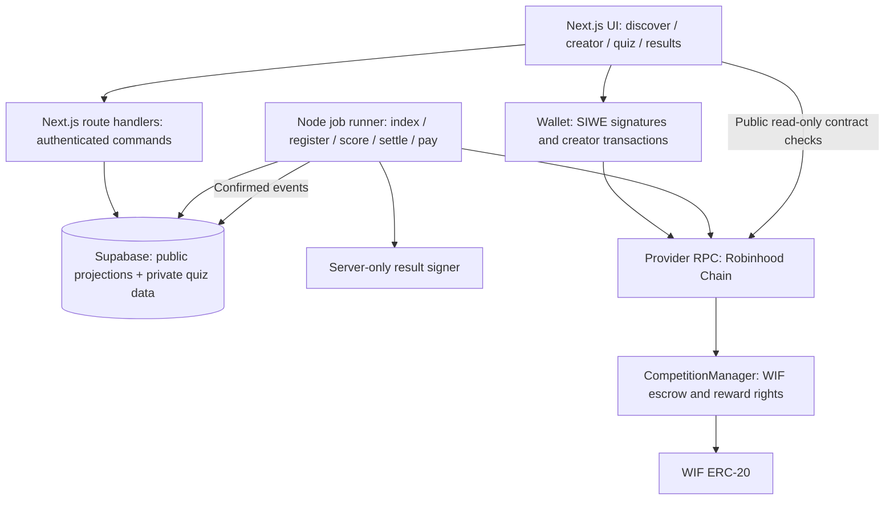
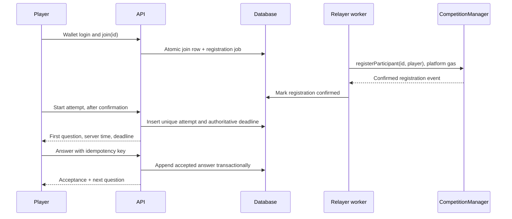

# Flat League architecture

One Next.js application, one principal Solidity contract, one Supabase database and one durable job runner. The worker is necessary because timed settlement, retries and sponsored transactions cannot depend on a browser staying open.

## System boundaries



### Stack

| Area | Choice and purpose |
| --- | --- |
| Web | Next.js 16 App Router and TypeScript; server-render public discovery, client islands for wallet/quiz/3D |
| Interface | Tailwind + shadcn/ui accessible primitives; custom component presentation |
| Wallet | wagmi + viem; injected wallets and WalletConnect via custom drawer |
| Data | TanStack Query; receipts invalidate relevant competition/balance queries |
| Database | Supabase PostgreSQL, SQL migrations and private schema |
| Auth | SIWE-style wallet login; server verifies signatures and creates its own cookie session |
| Contract | Solidity + Foundry + pinned OpenZeppelin version |
| Jobs | Small Node worker on a continuously running managed service, leasing jobs from PostgreSQL |
| Hosting | Vercel web/API, Supabase database, managed worker; provider RPC in production |
| Visual | Three.js/R3F/Drei, Framer Motion and GSAP with separate transform ownership |

Use provider pooling for serverless database connections. Pin mutually compatible versions when initializing; the plan does not certify a dependency combination that has not been installed.

## Contract model

`CompetitionManager` holds an immutable WIF address and per-competition records. It is non-upgradeable for the hackathon. No administrator withdrawal can touch accounted competition funds.

Suggested record:

```text
Competition {
  creator: address
  rulesHash: bytes32
  questionCommitment: bytes32
  resultSigner: address
  registrar: address
  pool: uint256
  startAt: uint64
  endAt: uint64
  finalizeBy: uint64
  maxParticipants: uint32
  participantCount: uint32
  status: Funded | Finalized | Cancelled | Refunded
}
participants[id][wallet]: bool
claimable[id][winner]: uint256
claimed[id][winner]: bool
resultNonce[id]: uint256
totalLiabilities: uint256
```

Scheduled/live/awaiting-results are time-derived UI states within `Funded`. Do not let an indexer database field override contract time or terminal state.

Snapshot signer/registrar addresses for each competition. Changing defaults affects new competitions only. Existing competitions cannot silently switch judging authority.

### Functions

| Function | Caller | Constraints and effect |
| --- | --- | --- |
| `createCompetition(config, amount)` | Creator | Exact WIF allowance; valid future times, nonzero pool, participant cap, commitments; transfer exact amount and create funded competition atomically |
| `registerParticipant(id, player)` | Competition's registrar | `Funded`; start ≤ now < end; nonzero unique wallet, cap not exceeded; server only registers a verified join |
| `finalizeCompetition(id, result, signature)` | Anyone | end ≤ now < finalizeBy; valid signed allocation; registered unique winners; total allocation = pool; consume nonce once |
| `claimReward(id)` | Winner | Finalized; unclaimed entitlement; send to caller |
| `claimFor(id, winner)` | Anyone | Same entitlement; recipient is always the stored winner, never the caller |
| `cancelCompetition(id)` | Creator | now < start and `Funded`; mark cancelled and refund pool |
| `refundExpiredCompetition(id)` | Creator | now ≥ finalizeBy and `Funded`; terminal refund |
| `refundNoContest(id, signedResult)` | Anyone | end ≤ now < finalizeBy; signer attests zero valid attempts; terminal refund to creator |

Create and fund in one transaction after approval. Separate public unfunded creation/top-up paths add states without helping this MVP. Drafts remain offchain, and pool/rules become immutable when created.

Use `SafeERC20`, `ReentrancyGuard`, checks-effects-interactions and restricted default-authority administration. Check the balance delta on funding; revert if received WIF differs from the requested amount. That protects accounting if token behavior differs from expectations. Deploy only after the transfer-behavior gate passes.

Finalization allocates rewards without transferring them. A failed transfer to one winner therefore does not block allocation to the others. `claimFor` lets the platform pay gas while preserving a winner's independent recovery path. Failed claims retain their liability; creator expiry refund never touches finalized rewards. No claim expiry or confiscation in the MVP.

Increment liabilities on funding and decrement only on a successful refund or reward payment. Donations remain surplus and do not enlarge a competition's pool. Invariant: `totalLiabilities <= WIF.balanceOf(manager)`.

### Signed settlement

EIP-712 domain: name `FlatLeague`, version `1`, chain ID and manager contract address.

```text
Result {
  competitionId: uint256
  rulesHash: bytes32
  resultArtifactHash: bytes32
  payoutsHash: bytes32
  nonce: uint256
  validUntil: uint64
}
Payout {
  winner: address
  score: uint16
  elapsedMs: uint32
  amount: uint256
}
```

Define `payoutsHash` with EIP-712 struct hashes: hash each typed `Payout`, then hash the concatenated ordered struct hashes. The exact type strings and encoder live in the shared package and are tested against Solidity. Do not mix packed dynamic encoding with standard ABI encoding.

Verify contract state, rules hash, signature, nonce, at most three winners, unique/nonzero/registered addresses, score bounds, time bounds and exact pool sum. `validUntil <= finalizeBy`; reject at `now >= validUntil`. The contract cannot independently establish quiz correctness. The result signer can misjudge results, but cannot pay an unregistered wallet, increase the pool or replay an allocation.

The no-contest signature has a separate EIP-712 type binding competition, rules, artifact, nonce and expiry. It cannot be replayed as a winning result. The signer has authority to declare no valid attempts; disclose this alongside result authority.

Store public artifact hash in the finalization event. Anyone can compare the published scoring transcript with the signed payout allocation.

## Creator flow

1. Authenticate creator wallet; save an offchain draft.
2. Enter title, schedule, ten questions, answer choices, correct answers and pool amount.
3. Validate content and schedule on the server. Freeze canonical rules and the question pack.
4. Compute `questionCommitment = keccak256(canonicalQuestionPack || randomSalt)` using an explicitly versioned byte serialization. The random salt prevents brute-forcing small answer keys from the commitment.
5. Show the exact WIF amount, 60/25/15 split, settlement deadline and gas estimate.
6. Request only the necessary WIF approval. After its receipt, request funded creation. If existing allowance suffices, omit approval.
7. Worker confirms event, matching creator, token, rules hash and amount; attaches the draft to the onchain ID.
8. Publish as scheduled/live only when confirmed. A missing database projection is repaired by backfill; it does not cause a second funding transaction.

Freeze creator edits at funding. A public rules JSON endpoint exposes all competition rules but excludes answer keys and salt until the end. Closing publication reveals the pack/salt and lets observers verify the commitment; it is an audit of a trusted server, not a cryptographic proof of fair judging.

## Free player flow



Wallet connection alone does not authenticate. Verify SIWE domain, URI, wallet, chain, one-use random nonce, issued time and expiry. Support deployed smart-wallet signatures through ERC-1271 verification; explicitly disclose unsupported undeployed smart wallets if necessary.

Session cookie: HttpOnly, Secure, SameSite=Lax, short expiry. Check Origin/CSRF for writes. User address comes from the verified session. Chain switching is needed for creator transactions; a player's offchain login does not require holding ETH or WIF.

Joining opens registration, with platform-paid gas. Show `Registering your place` until the receipt confirms, then `Start run`. Registration begins only when live; upcoming competitions can be bookmarked locally, but are not shown as onchain entries. If registration is too late to fit a full attempt before the end, reject starting clearly.

Avoid requiring the player to pay gas when the relayer fails. Show a pending/retry state, preserve their join request and alert operations. A verified registration is a prerequisite for starting a prize-eligible attempt.

## Quiz and ranking

- Atomic unique `(chain_id, competition_id, wallet)` attempt constraint prevents two simultaneous starts.
- Server assigns an unpredictable attempt ID and shuffles the same frozen question set and choice order.
- Attempt deadline is `min(startedAt + 120s, competitionEnd)`. API requires at least 120 seconds remaining before starting.
- Send one question at a time, without correct answers, correctness feedback or explanatory hints until closing.
- Each answer carries attempt ID, question ID, option ID and idempotency key. Validate the session, ordering, membership and server receipt time in a database transaction.
- Answers lock after acceptance. Do not send correct/incorrect styling during the timed attempt.
- Retrying an accepted key returns the original acknowledgement. A new key cannot overwrite a locked answer.
- At timeout, score accepted answers; unanswered questions score zero. Full completion time is the final accepted answer's server timestamp minus start; timed-out runs use 120 seconds.
- A valid attempt has confirmed registration, a valid start and at least one accepted answer. Wrong answers may yield a valid zero score; an abandoned attempt with no accepted answers is excluded from prizes.
- Sort by score descending, elapsed ascending, start ascending, wallet numeric ascending. Publish the tie rule before participation.
- Keep leaderboard provisional until all attempts have expired and the worker freezes one result version. Anyone completing later in the open round can change provisional rank.
- Finalized results and actual payout receipts drive public history. Never derive paid rewards from a browser's local quiz state.

For N valid winners (N = min(3, valid attempt count)), take the first N weights from [60, 25, 15] and divide by their sum. Floor-round ranks 2/3 in base units, and assign the remainder to rank 1. The creator commits these weights in the rules hash. With one winner the full pool goes to that winner; zero valid attempts use signed no-contest refund.

Refresh resumes the same attempt with its original deadline and accepted answers. A session expiring mid-attempt does not reset the clock. An offline selection is not accepted until acknowledged by the server; reconnect retries the same key, subject to the original deadline.

The server's clock is authoritative. Return `serverNow`/deadline; estimate client offset for display and use a monotonic clock locally. Background tabs may throttle animation but do not extend the server deadline. Timing measured at server receipt includes network latency, a disclosed limitation of this MVP.

## Database

| Table | Key data and invariants |
| --- | --- |
| `profiles` | Normalized wallet, optional display name; generated identicon, no upload pipeline initially |
| `competition_drafts` | Creator/session identity, draft version, editable content; private until funded |
| `competitions` | `(chain_id, manager, onchain_id)` unique; metadata, rules hash, pool as exact integer/decimal string, source block, projection state |
| `private.question_packs` | Canonical frozen questions, answers and salt; inaccessible through public PostgREST |
| `participants` | Competition + wallet unique; join state, registration hash and confirmed block |
| `private.attempts` | Unique competition + wallet; start/deadline, state and frozen score |
| `private.answers` | Attempt + question unique; selected option, accepted time, idempotency key unique per attempt |
| `results` | One frozen version; public artifact, hash, signature, payout allocation and finalization receipt |
| `reward_claims` | Competition + winner unique; entitlement, actual claim event/hash, delivery status |
| `chain_events` | Chain + transaction + log index unique; block number/hash, confirmed/canonical flags |
| `jobs` | Kind, unique effect key, status, lease expiry, retries, tx hash, attempt error |
| `auth_nonces` / `sessions` | Nonce hash, consumption/expiry; session token hash and wallet identity |
| `worker_state` | Indexed cursor/hash, relayer nonce lease and reconciled pending transactions |

Use RLS deny-by-default. Browser access is limited to curated public projections. Private question/attempt schemas are not exposed through Supabase's public API. Server-side authoring permissions come from the verified wallet session; the service-role key is never sent to clients. Escape creator content and render plain text/controlled Markdown.

Use PostgreSQL `numeric(78,0)` or an equivalent exact integer representation for uint256 amounts, serialized as strings; frontend uses `bigint` and viem `parseUnits`/`formatUnits`. Never convert WIF base units to JavaScript floating-point numbers for accounting.

### Route contract

| Endpoint | Purpose |
| --- | --- |
| `GET /api/auth/nonce` / `POST /api/auth/verify` | Single-use signature challenge and cookie session |
| `GET /api/competitions` / `GET /api/competitions/:id` | Public projected data plus confirmation timestamps |
| `POST /api/competition-drafts` / `PATCH .../:id` | Creator-private authoring |
| `POST /api/competition-drafts/:id/freeze` | Final config, canonical hashes and publish-ready transaction inputs |
| `POST /api/competitions/:id/join` | Verified wallet, unique join and registration job |
| `POST /api/competitions/:id/attempts` | Atomic one-time start |
| `GET /api/attempts/:id` | Resume own attempt, server time and current question |
| `POST /api/attempts/:id/answers` | Idempotent ordered answer acceptance |
| `POST /api/attempts/:id/finish` | Idempotent completion/expiry acknowledgement |
| `GET /api/competitions/:id/results` | Provisional/frozen/finalized result and post-close audit artifact |
| `POST /api/competitions/:id/rewards/deliver` | Authenticated winner asks for idempotent sponsored delivery |

Stable error codes accompany plain-language messages. Job execution and signing are worker-only, not unauthenticated public API routes.

## Job runner and chain consistency

Use PostgreSQL leases with `FOR UPDATE SKIP LOCKED`, unique effect keys, exponential backoff and a maximum retry policy with an operator alert. A job is at least once; its effect must be idempotent.

Registration worker sends immediately when capacity allows. Initial design uses one serialized relayer writer to avoid nonce races; batching is optional later. Track nonce, raw signed transaction/hash and receipt before retrying. After an uncertain send, query for the original transaction and contract state rather than broadcasting a new effect blindly. Underpriced/stuck replacements reuse the same nonce.

Separate result signer, registrar/relayer and deployment admin keys. The relayer holds a capped ETH balance. The signer only signs frozen allocations matching confirmed escrow and registered wallets. Secrets stay in worker/server environments; no `NEXT_PUBLIC_` signing or service-role keys.

At closing: freeze attempts, reveal committed pack, produce artifact, compare pool/participants against chain, sign result, submit finalization, verify receipt, enqueue up to three payouts. Keep a buffer before `finalizeBy` and alert early. Default settlement grace is 24 hours and is shown in the creator/player rules; signed results expire no later than that cutoff.

Indexer backfills `eth_getLogs` from deployment block in bounded ranges. Store block hashes and reconcile reorgs. Choose the confirmation threshold using official chain finality guidance during implementation; distinguish submitted, confirmed and indexed states. Cron/restarts must replay safely from the persisted cursor. The UI can verify the known receipt while waiting for the public projection.

Monitor API health, RPC lag, last worker heartbeat, unresolved jobs, expiring competitions, relayer ETH and unpaid finalized entitlements. Test restart after broadcast, database outage, expired lease, out-of-gas and reorg reconciliation before release.

## Repository structure at implementation

```text
flat-league/
  apps/web/
    app/{discover,competitions,create,leaderboard,profile,api}/
    components/{ui,layout,competition,quiz,wallet,3d}/
    hooks/ lib/ styles/
  apps/worker/
    src/{indexer,registrar,scorer,settler,payouts}/
  contracts/
    src/CompetitionManager.sol
    test/ script/ foundry.toml
  packages/contracts/       # generated ABI + deployment records
  packages/shared/          # canonical rules, EIP-712 types, scoring schema
  supabase/migrations/
  docs/ evidence/
  .env.example
```

MockWIF is testnet-only and explicitly labeled. Do not assume the mainnet WIF address has a valid testnet deployment. Local/Foundry mocks exercise token edge behavior; a mainnet fork and limited real transactions establish compatibility with the actual token.

## Meaningful verification

Contract tests cover exact deadline boundaries, liability invariants across competitions, signature encoders, cross-chain/contract replay, unauthorized registrar/signer, over-allocation, nonparticipants, duplicate winners/claims, no-contest/refund races, failed token transfer and reentrancy. Fuzz pool sizes and payout rounding.

Backend integration tests cover nonce consumption, SIWE domain/chain/expiry, RLS leakage, concurrent attempt starts, deadline skew, ordered answers, idempotent retry, deterministic ties and worker replay. Browser checks exercise creator allowance/funding and a second wallet's registration/quiz/reward path, including a recovered pending transaction.

## Trust and product limits

The backend knows the answer keys and controls scoring; the result signer can select among registered participants. Commitment/replay artifacts make manipulation detectable after closing, not impossible. The registrar determines whose verified join is placed onchain, so outages or censorship can prevent participation. Both authorities are public in the rules.

One wallet per attempt does not establish one person per attempt. Rate limits, optional challenge checks and low initial prize caps reduce abuse but cannot prevent determined Sybil attacks, answer sharing or AI assistance. Timed knowledge quizzes are not a proven bot-resistant skill mechanism. Test this with real users before increasing rewards or presenting the platform as cheat-proof.

Creator-funded free participation avoids an entry-stake mechanism; it does not settle all jurisdictional or promotion questions. Paid-entry mechanics are outside the MVP. Stock Tokens are outside the product scope, so their category-specific restrictions are not an assumed project requirement.
