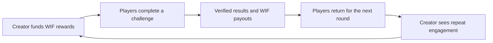

# Flat League build plan

Planning baseline: November 2, 2026. Capacity assumption: one builder. Deadline: November 12 at 17:30 UTC. Operational commitment: keep the judged release functional through November 16 at 17:30 UTC.

Implementation checkpoint: the local MVP is built; see [current implementation, verification and release limits](IMPLEMENTATION.md). Checked implementation tasks below describe local functionality. Production, real WIF and submission gates remain separate.

## Product and recurring use

Creators publish skill challenges and escrow WIF rewards. Players join free, complete a timed run, compare scores and receive any earned reward. The next scheduled challenge is visible from the results screen.

The recurring loop is:

The sponsor gets a recurring community activity, a shareable result and an engagement report. The player gets a short skill challenge, competitive history and possible WIF rewards. There is no yield, second token, mandatory staking or automatic burn.

The loop depends on creators choosing to fund another challenge. Reward distribution alone does not establish sustainable demand. Measure returning players and returning sponsors rather than assuming winners will reinvest.

### First usable competition

| Property | MVP rule |
| --- | --- |
| Mode | Knowledge Run |
| Questions | Ten curated multiple-choice questions |
| Attempt | One per wallet per competition |
| Time | 120 seconds, measured by the server |
| Window | Creator selects start/end; defaults to a short scheduled round |
| Scoring | Ten points per correct answer; maximum 100 |
| Tie breaks | Lowest server-measured completion time, then earlier accepted attempt start, then numerical wallet address |
| Rewards | Up to three ranked winners; default weights 60/25/15 |
| Pool | Creator-funded WIF, fully escrowed before the competition is shown as funded |
| Cost to player | No entry fee; platform pays registration and routine payout gas |
| Settlement | After the competition ends; provisional rankings carry no claim rights |
| Cancellation | Creator can cancel only before the start |
| Failure to settle | Creator can recover unallocated escrow after the published settlement deadline |

Hide answer keys until the competition ends. Shuffle question and answer order without changing the question set. Publish the frozen question pack, scoring version and result artifact afterward. Open-ended quizzes remain vulnerable to answer sharing and external tools; see the architecture limitations.

If fewer than three players complete valid attempts, use the first N prize weights and renormalize over N. Allocate floor-rounded amounts for ranks 2/3 and give the remainder to rank 1. If no valid attempt exists, refund through the no-winner settlement path. These rules must appear before a player starts.

## Build sequence and acceptance gates

| Date | Build | Observable acceptance gate |
| --- | --- | --- |
| Nov 2 | Network/token research, repository foundation, contract/API types, design tokens, database setup | Official settings documented; direct WIF reads pass; local web shell renders; secrets have server-only boundaries |
| Nov 3 | Atomic WIF-funded creation, escrow, registrar, expiry/cancellation | Foundry lifecycle tests pass; testnet MockWIF competition created; participant registration confirmed |
| Nov 4 | EIP-712 finalization, reward allocation, `claimFor`, refunds, negative cases | Complete settlement on testnet; replay, overpayment and terminal-state tests pass |
| Nov 5 | Wallet auth, private question storage, attempt/answer APIs, server timing | A wallet can authenticate and finish a scored attempt; concurrent duplicates and leaked answers are rejected |
| Nov 6 | Discover, detail, creator form, quiz room, persistent transaction UI | Creator and player journeys work against testnet without developer intervention |
| Nov 7 | Indexer, scorer/relayer job runner, results and next-round loop | Two complete testnet competitions including restart/retry recovery; totals match receipts |
| Nov 8 | Mainnet transfer gate, deploy and verify contract, production release | Real funding, registration, finalization and reward transfer with documented hashes |
| Nov 9 | External testing and first recurring rounds | At least one external participant completes a round; sponsor/player feedback captured; reward receipt independently checked |
| Nov 10 | Full Flat Core scene, page choreography, podium transitions, mobile polish | Performance and reduced-motion gates pass; third completed competition; no blocker errors |
| Nov 11 | Security review, README, release candidate, demo script/recording | Judge journey reproducible; evidence complete; production tag/commit identified |
| Nov 12 | Final smoke check and early submission | Submit by 13:30 UTC; save confirmation; preserve the judged release |
| Nov 12–16 | Monitor uptime, job execution, escrow and payout delivery | Existing release stays functional; scheduled competitions and monitoring continue |

Start design tokens, wireframes and the static 3D fallback on day one; develop the visual shell beside the contract loop. Finish expensive visual effects once the core lifecycle passes. The 3D identity remains part of the deliverable.

After submission lock, preserve the submitted code/deployment. Check with organizers before a corrective code change; ordinary operation of the submitted release, new competitions and payouts are planned in advance. The published logo exception does not authorize other edits.

## Work packages

### P0 — required to submit

**Network and contracts**

- [x] Confirm official mainnet/testnet IDs, gas currency and explorer URLs.
- [x] Cross-check the WIF address against the project website.
- [x] Read WIF bytecode, symbol, decimals, `balanceOf` and `allowance` on mainnet.
- [ ] Inspect verified token source or otherwise establish transfer restrictions; run real transfer/approval/escrow checks.
- [x] Implement immutable WIF reference and per-competition escrow accounting.
- [x] Implement atomic funded creation with a frozen rules hash and deadlines.
- [x] Implement free sponsored participant registration and participant limit.
- [x] Implement EIP-712 verification, winner validation and finalization.
- [x] Implement fixed-recipient reward claims and sponsored `claimFor`.
- [x] Implement pre-start cancellation, no-winner refund and expiry refund.
- [ ] Test replay, duplicate winners, unauthorized actions, reentrancy, failed transfers, rounding and exact time boundaries.
- [ ] Deploy and verify testnet and mainnet contracts; export ABI/address configuration.

**Backend and operational loop**

- [ ] Supabase migrations, unique constraints, public/private schema split and deny-by-default RLS.
- [x] Wallet authentication with a one-use SIWE nonce and secure sessions.
- [x] Creator draft authoring, frozen question pack and salted commitment.
- [x] Authenticated join API and recoverable sponsored-registration jobs.
- [x] Atomic attempt start, server deadline, idempotent answer acceptance and expiry.
- [x] Deterministic scoring, frozen rankings and public post-close result artifact.
- [x] Server-only EIP-712 signing; durable settlement/payout queue.
- [ ] Event indexer with backfill, confirmation threshold and reorg reconciliation.
- [ ] Rate limits and abuse controls with disclosed limits.
- [ ] Operational view for stale jobs, failed payouts and relayer ETH balance.

**Product UI**

- [x] Responsive public landing page with the Flat Core Three.js scene and static fallback.
- [x] Discover filters and live/funded/ended competition cards.
- [x] Detail screen with rules, escrow, reward split, creator and participation state.
- [x] Wallet drawer, account change handling and creator network switching.
- [x] Creator draft, schedule, question authoring, approval and funded publication flow.
- [x] Sponsored join state, preflight and lightweight timed quiz room.
- [x] Answer retry, deadline, reload and disconnection recovery.
- [x] Competition leaderboard with provisional/final/payout labels.
- [x] Reward receipt and creator funding activity with explorer links.
- [x] Next-round action and competition sharing.
- [x] Framer Motion interactions, GSAP landing scroll, reduced motion and keyboard/focus support. Browser checks cover fallback/DOM behavior; physical GPU performance remains a release gate.
- [ ] Loading, empty, wrong-chain, insufficient-funds and network-failure states.

**Submission**

- [ ] Public repository with setup, architecture, trust assumptions and deployment instructions.
- [ ] Production URL and exact release commit/tag.
- [ ] Verified mainnet contract address and signer/registrar addresses.
- [ ] Funding, participant registration, finalization and reward transaction hashes.
- [ ] At least one external participant and one complete live competition.
- [ ] Approximately two-minute demo video.
- [ ] Category selection: Games, Consumer and payments, Social and creators. Add Tools and infra only if the reusable API is demonstrated.
- [ ] Submission confirmation saved; hosting, RPC, worker and gas budgets cover the final.

### P1 — after the lifecycle passes

- [x] Public profile with participation history and confirmed rewards in the configured token.
- [x] Global seasonal leaderboard: placement points 10/6/4 for top three, then one per other valid completion; one award per competition per wallet.
- [ ] Creator engagement report: distinct participants, returning wallets and settlement receipts.
- [ ] Creator can duplicate a completed challenge as a new funded round.
- [ ] Optional registration/payout batching after concurrency behavior is verified.
- [ ] Results celebration and podium camera treatment within the motion budget.

A seasonal leaderboard measures competitive history; it is not proof of unique humans or comparable difficulty across every quiz. The competition leaderboard is authoritative for its own prizes.

### Defer

AI-generated questions, agent competitions, team modes, NFTs, onchain reputation, chat, paid entry, swaps, staking, mobile apps, Stock Token integrations and platform fees.

## Release gates

| Gate | Evidence needed |
| --- | --- |
| Contract accounting | Total liabilities never exceed actual token balance; each competition can allocate/refund only its own pool |
| Authentication | Replayed/expired/wrong-domain signatures rejected; wallet identity never trusted from a request body |
| Quiz integrity | Answer keys absent from client bundles and public API/RLS reads; duplicate attempt concurrency test passes |
| Timing | Server controls deadlines; clock skew, retries, refresh and exact cutoff behavior verified |
| Settlement | Tampered signature, wrong chain/contract, unregistered winner, duplicate claim and expiry race rejected |
| Recovery | Restart after tx broadcast does not duplicate effects; failed sponsored payout remains independently claimable |
| Integration | Browser journey completes from creator funding through another wallet's reward receipt |
| Design | 390px mobile and 1440px desktop reviewed; keyboard, focus and reduced-motion behavior pass |
| Performance | LCP target ≤2.5s, INP ≤200ms, CLS ≤0.1; 3D failure does not block actions |
| Evidence | All displayed real activity corresponds to a confirmed event/receipt; demo data is clearly marked |

Test contract and backend behavior where funds, identity, deadlines or retries are involved. Use focused browser checks for visual polish instead of tests that simply mirror CSS implementation.

## Schedule pressure

If the complete testnet lifecycle is not working by November 7, cut global rankings, profile customization, creator analytics and extra postprocessing first. Keep the 3D hero, key interactions and functional competition leaderboard.

If creator authoring becomes the bottleneck, launch with operator-curated question packs while retaining permissionless creator WIF funding. Label that limitation in the UI and README. Do not claim general-purpose question authoring if it is absent.

Mainnet release waits for funds/settlement gates. A realistic mock screen cannot replace real WIF transactions.

## Internal traction targets

| Metric | Target | Definition |
| --- | --- | --- |
| External participants | 10–20 | Distinct non-team wallets completing a valid attempt; wallets do not establish human uniqueness |
| Completed competitions | At least 3 | Finalized and paid competitions with public receipts |
| Repeat participation | At least 30% | Wallets with two or more completed rounds / wallets with one or more, over the demo period |
| Returning sponsor | At least 1 | A creator funds another competition after reviewing their first round |

These are product goals, not official judging thresholds. Record test/team wallets separately and do not manufacture traction.

## Demo narrative

0:00–0:20: show the 3D identity and explain free skill competition with creator-funded WIF. 0:20–0:45: creator chooses a challenge and funds the pool. 0:45–1:15: a second wallet joins and completes a run. 1:15–1:40: show frozen results and the disclosed scoring authority. 1:40–2:00: show real reward transfer, participant history and the next round.

Record the real flow first. Compose or edit the requested demo video later under the applicable media workflow.
